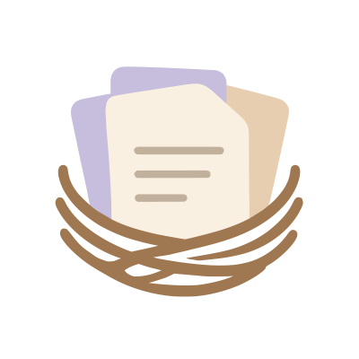

<div align="center">



# Clipnest — a fast, private clipboard manager for Mac

**Never lose a copy again.** Clipnest is a lightweight, native **macOS clipboard manager** that quietly remembers everything you copy — text, links, images, and files — and hands it back the instant you need it. Hit a hotkey, search, paste. Plus reusable **snippets** you can expand by keyword in any app, and a full **Settings window** to make it yours.

[](#requirements)
[-E95420)](#linux-ubuntu)
[](#how-its-built)
[](#privacy-first)
[](LICENSE)

</div>

---

**Website & docs → [aayushgour.github.io/clipnest](https://aayushgour.github.io/clipnest/)** · [Changelog](CHANGELOG.md) · Clipnest by Aayush Gour — not affiliated with other apps named ClipNest.


## Why Clipnest?

macOS 26 Tahoe added a basic clipboard history to Spotlight (⌘4) — but it's opt-in, caps out at 7 days, and can't organize or pin anything. Clipnest is a free, open-source, native menu-bar app that picks up where that leaves off: history you control, instant search, pinned favorites, and reusable snippets you can drop into any app by their Tag.

**Update Clipnest and you don't have to re-grant Accessibility — your permission survives, because every release is signed with the same certificate.** Most apps that rebuild or re-sign between versions quietly invalidate that grant, so a routine update leaves you back in System Settings, re-adding the app by hand. Clipnest doesn't do that to you, by design — see [Signing, honestly](#release) for exactly how.

It's free and open source, built in pure SwiftUI/AppKit — no Electron, no web view, no account, no cloud, no telemetry. Its **snippets** are reusable text — a signature, boilerplate, a command — that you insert into any app in one keystroke: type the snippet's Tag, select it, press **⌥⌘E**. It's a deliberate shortcut, not as-you-type auto-expansion — see [Snippets & keyword expansion](#snippets--keyword-expansion).

**Also on Linux.** Since 1.0, Clipnest runs on Ubuntu with GNOME (X11 or Wayland) with the same history, search, pinning, snippets and on-device OCR — see [Linux (Ubuntu)](#linux-ubuntu).

> Looking for a **free, open-source clipboard manager for Mac** — a lightweight alternative to Paste, Maccy, or Pastebot? Clipnest is a fresh, from-scratch take built in pure SwiftUI.

## Install

Requirements: macOS 14 (Sonoma) or later, Apple Silicon or Intel. (Building from source needs Xcode — see [Requirements](#requirements).)

### One command (recommended)

Run this in Terminal:

```bash
curl -fsSL https://raw.githubusercontent.com/AayushGour/clipnest/main/scripts/install.sh | bash
```

The script detects your system (`uname -s`), fetches the latest release and verifies its SHA-256 before installing anything. Clipnest installs into your Applications folder and launches. Look for its icon in the menu bar, then press **⌥⌘V** to open the picker. The installer downloads over `curl` (which never sets macOS's quarantine flag, so there's no Gatekeeper "unidentified developer" dialog; it also clears the flag on the app it installs) and verifies the `.dmg` against a published SHA-256 checksum before ever mounting it — see [Release](#release) for why.

Environment variables: `CLIPNEST_DRY_RUN=1` does everything except the install (detect, download, verify); `CLIPNEST_FORCE=1` lets the Linux path continue on an unsupported system; `GITHUB_TOKEN` raises the GitHub API rate limit.

### Or download the `.dmg`

Grab the `.dmg` (and its `.dmg.sha256`) from the [latest release](https://github.com/AayushGour/clipnest/releases/latest), open it, and drag **Clipnest** into Applications. A browser download is quarantined by macOS, and Clipnest is not notarized, so the first launch is blocked:

- **macOS 15 (Sequoia) and later:** the dialog has no Open button. Dismiss it, open **System Settings → Privacy & Security**, scroll to the message about Clipnest, click **Open Anyway** and confirm (macOS asks for your admin password). Control-click → Open no longer works on macOS 15+. (On macOS 14, Control-click → **Open** still works.)
- **Terminal alternative (any version):** `xattr -dr com.apple.quarantine /Applications/Clipnest.app`

This is a one-time step. The one-command install above avoids it.

### Update

```bash
curl -fsSL https://raw.githubusercontent.com/AayushGour/clipnest/main/scripts/update.sh | bash
```


Updates Clipnest to the latest version, if a newer one is available. Same checksum verification as Install. Before replacing anything it checks that the new app's version matches the release and that its code signature is valid and made by the same signer as your installed copy (a mismatch aborts with a `SECURITY` message and leaves your app untouched). The new app is copied next to the old one and swapped in only after those checks pass, and the old one is restored if the swap fails. You can also trigger this from inside the app: choose **Check for Updates…** from the menu-bar icon (Linux: the tray icon) for an immediate check — it tells you "You're up to date (x.y.z)" or offers the update, and works even with the automatic daily check turned off; or click the version number in the picker's footer (it shows a small dot when an update is available) and confirm — Clipnest opens Terminal and runs the update script for you, then relaunches itself. The in-app flow runs the script from the **release tag** being installed (for example `.../v1.4.1/scripts/update.sh`), not from the moving `main` branch, and tells it to install exactly that version (`CLIPNEST_VERSION=v1.4.1`). Advanced: `CLIPNEST_VERSION=vX.Y.Z` before `bash` pins a specific release yourself. On Linux the picker footer also shows the version (with the same dot); clicking it opens Settings, where **Check for Updates Now** / **Install Update…** live.


## First run

Clipnest shows a short **Welcome** window once (also the first time after you update from an older version) with three steps:

1. **Accessibility** (System Settings → Privacy & Security → Accessibility) so Clipnest can paste directly into other apps and insert snippets. **Continue** stays disabled until it is allowed; a low-key **Set up later** asks you to confirm that picking an item will then only copy it and snippets will not expand.
2. **Open Clipnest at login** — a switch, pre-checked, applied when you continue; the same setting as Settings → General.
3. **Try your hotkey** — a quick check that your hotkey opens the picker.

The hotkey opens the picker, and capturing and searching work, even without Accessibility. Close the window any time with Esc and reopen it from the menu-bar icon → *Getting Started…*. While it is open Clipnest shows its Dock icon (macOS needs that to bring the window to the front); the icon disappears when you close it.

## Everyday use

1. Clipnest lives in your **menu bar** — no Dock clutter day-to-day (opening Settings is the one exception; see [Settings](#settings)).
2. Copy things like you normally would; Clipnest remembers them.
3. Press **⌥⌘V** (or click the menu-bar icon → *Open Clipnest*) to open the picker at your cursor.
4. **Type** to search, **↑/↓** to move, **Return** to paste into whatever you were doing.
5. **Pin** the ones you reuse most, save handy text as **Snippets**, and insert them anywhere: type the Tag, select it, press **⌥⌘E**.
6. Tune capture, retention, excluded apps, and shortcuts any time from **Settings** (menu-bar icon → *Settings…*, or **⌘,**).
7. Need a break? Menu-bar icon → *Pause Capture*. While paused the menu-bar icon is dimmed with a pause mark, and it stays paused across relaunch.


### Keyboard shortcuts

| Action | Shortcut |
| --- | --- |
| Open Clipnest | `⌥⌘V` |
| Expand snippet by Tag (in any app) | `⌥⌘E` |
| Search | `⌘F` |
| Move selection | `↑` / `↓` |
| Paste selected | `Return` |
| Paste without formatting *(rich text → plain; recognized-text images → that text)* | `⌥Return` |
| Pin / unpin | `⌘P` |
| Save history item as snippet *(text/link items only)* | `⌘S` |
| New snippet (Snippets tab) | `⌘N` |
| Edit highlighted snippet (Snippets tab) | `⌘E` |
| Next / previous type filter (History, Pinned) | `⌘]` / `⌘[` |
| Show / hide preview of the highlighted item | `⌘Y` |
| Delete entry | `⌘⌫` |
| Switch tabs (History / Pinned / Snippets) | `⌘1` / `⌘2` / `⌘3` |
| Open Settings *(picker or Settings window focused — not global)* | `⌘,` |
| Close | `Esc`, or the × button at the right of the picker header |

Both the picker hotkey and the snippet-expansion hotkey are rebindable in Settings → Shortcuts; ⌥⌘V / ⌥⌘E above are just the defaults. **⌥Return** only behaves differently from plain **Return** where there's actually something to strip: on **rich text** items it pastes the plain-text form instead of the formatted one, and on an **image row with recognized text** (OCR — see [Settings](#settings)) it pastes that text instead of the image, falling back to pasting the image itself if nothing was recognized. On plain text, links, files, and images with no recognized text, ⌥Return pastes exactly what Return does — there's no richer form to strip. An image also gets a "Copy Recognized Text" action in its right-click menu when it has recognized text, alongside a small badge on its thumbnail. **⌘S** saves a highlighted text or link item as a snippet; it's a no-op on image, rich-text, and file rows, matching those rows' own UI, which never offers a "Save as Snippet" action there. **⌘,** opens Settings while the picker is focused (closing the picker first, then opening and focusing Settings) or while the Settings window itself is already focused — it's deliberately not a global hotkey, so pressing it from any other app does nothing and never steals that app's own ⌘, shortcut.

### Troubleshooting (macOS)

**"Clipnest couldn't open its history"** — shown at launch if the history database is unreadable and automatic recovery didn't work. Choose **Reset History…** to start fresh (after a confirmation, both your clipboard history *and* snippets are moved — not deleted — into a `Reset-Backup-<timestamp>` folder inside `~/Library/Application Support/Clipnest`), **Show in Finder** to inspect the data folder yourself, or **Quit**.


## Features

- 📋 **Full clipboard history** — automatically captures everything you copy: plain text, rich text, URLs, images, and files.
- 🛡 **Accessibility permission survives updates** — update Clipnest and you don't have to re-grant Accessibility: your permission survives, because every release is signed with the same certificate (see [Signing, honestly](#release)).
- ⚡ **Global hotkey** — press **⌥⌘V** anywhere to pop the picker open right at your cursor, over any app (even full-screen).
- 🔎 **Instant search** — start typing to filter your entire copy-paste history in real time, with matches highlighted.
- 🏷 **Type filters** — narrow the list to just text, images, files, or links with one click.
- 🗂 **Tabs** — **History**, **Pinned**, and **Snippets**, switchable with ⌘1 / ⌘2 / ⌘3.
- 👋 **Welcome window** — a one-time, three-step intro on first launch (and once after updating from an older version): allow Accessibility (Continue unlocks once it is on; a low-key *Set up later* asks you to confirm what will not work), choose to open Clipnest at login (pre-checked, so history keeps recording after a reboot), then try your live hotkey. Close it any time with Esc; reopen via *Getting Started…* in the menu-bar (macOS) or tray (Linux) menu.
- ↩︎ **Paste into your active app** — pick an item and, with Accessibility granted, Clipnest types it straight into the field you were using; otherwise it's placed on your clipboard to paste yourself.
- 🅰 **Paste without formatting** — **⌥Return** only differs from plain **Return** where there's actually something to strip: on **rich text** items it pastes the plain-text form instead of the formatted one, and on an **image row with recognized text** (see OCR below) it pastes that recognized text instead of the image. On plain text, links, files, and images with no recognized text, ⌥Return pastes exactly what Return does — there's nothing richer to strip.
- 🔍 **On-device text recognition (OCR), off by default** — let Clipnest read the text in your screenshots so you can find them by what they say, not just when you copied them. Turn it on in Settings → History; see [Privacy](#privacy-first) for the trade-off before you do.
- 👁 **Hover previews** — hover over an item (or, with **Settings -> General -> "Show preview when selecting with the keyboard"** on, arrow to it) and a popover shows the full content: the image at up to 40% of screen width (with any recognized text shown below it), the full scrollable text (loaded in chunks for huge clips), or a file's name, size, and path.
- 📌 **Pin your favorites** — keep the items you reuse most pinned to the top, always a keystroke away.
- 🧠 **Smart de-duplication** — copy the same thing twice and it won't clutter your history.
- ✂️ **Snippets** — save reusable text (a signature, boilerplate, a command) with a **Tag**, and paste it from the Snippets tab or **insert it into any app by its Tag** (type it, select it, press the expand shortcut — see below). Turn a text or link history item into a snippet with **⌘S** — the only kinds ⌘S applies to, since those are the only ones with a plain-text body to seed one from.
- ⚙️ **A real Settings window** — General, History, Apps, Shortcuts, and Permissions tabs to tune Clipnest to how you work (see below). Open it from the menu-bar icon → *Settings…*, or with **⌘,**.
- ⌨️ **Keyboard-first** — arrows to move, Return to paste, Esc to dismiss, ⌘F to search, ⌘P to pin, ⌘⌫ to delete, ⌘1/2/3 for tabs, ⌘[ / ⌘] to cycle the type filter, ⌘E to edit a snippet, ⌘Y to preview, ⌘, for Settings. **VoiceOver** reads each row as one labelled item ("Text, pinned, 2 minutes ago: …") with Pin, Delete, Save as Snippet, Paste as plain text and Edit as actions.
- 🪶 **Featherweight & native** — pure Swift/SwiftUI, a few MB, sips almost no memory, feels like part of macOS. Lives in the menu bar with no Dock icon day-to-day (opening Settings briefly shows one — see [Settings](#settings)).
- 🔒 **Private by design** — everything stays on your Mac. See [Privacy](#privacy-first).


## Snippets & keyword expansion

Snippets are reusable bits of text you author yourself (unlike captured history). Create one in the **Snippets** tab (⌘N) or save any history item as a snippet (⌘S). Each snippet has a **Tag** and a **Body** (what gets pasted). The Tag doubles as the expansion keyword. Tags must be unique: matching ignores case and surrounding spaces, and saving a duplicate tag is blocked with a message naming that snippet.

**Expand anywhere:** nothing expands automatically as you type. Type a snippet's Tag in *any* app, select it, and press **⌥⌘E** (rebindable in Settings → Shortcuts; the snippet editor shows your current shortcut) — Clipnest replaces the selection with the snippet's Body.

It works in **every** application, using a two-tier approach:

1. **Accessibility first** — in native / most Cocoa text fields, it reads and replaces the selection directly, without ever touching your clipboard.
2. **Clipboard fallback** — where the Accessibility API can't read the selection (Electron/Chrome apps like VS Code, Slack), it synthesizes copy/paste — which every app supports — while **snapshotting and restoring your clipboard** so it's left exactly as it was, and suppressing Clipnest's own capture of the transient copy/paste.

**If it can't expand, Clipnest says why instead of beeping, and nothing changes:**

| Situation | Message |
| --- | --- |
| Nothing selected | "Select a snippet tag, then press the shortcut." |
| No snippet uses the selected text | "Check the tag in the Snippets tab." |
| Accessibility missing (macOS) | "Turn it on in Settings > Permissions." |
| The app didn't accept the replacement | "Try again, or paste from the picker." |

On the Mac this is a small message near the pointer that never takes focus and is hidden from screen sharing. On Linux it is a desktop notification (needs `/usr/bin/gdbus` or `/usr/bin/notify-send`; otherwise a terminal bell).


## Settings

Everything about how Clipnest behaves lives in one Settings window, across five tabs. Open it from the menu-bar icon → *Settings…*, or press **⌘,** while the picker or the Settings window itself is focused — deliberately not a global hotkey, so it never takes ⌘, away from whatever other app you're using (that app's own shortcut keeps working normally). One side effect worth knowing: opening Settings briefly shows Clipnest's Dock icon — macOS won't bring a menu-bar-only app's window to the front without one — and it disappears again once you close the window.

- **General** — launch Clipnest at login, pause clipboard capture with one toggle (the menu-bar icon dims with a pause mark while paused), and turn the background update check on/off.
- **History** — controls how much history is kept. The default is the most recent **2,500** items (raised from 1,000 in 1.6.0; a limit you chose yourself is kept); switch to a day-based cap (30 days by default) or *Everything* (no cap at all) instead. Pinned items are always kept regardless of the cap. **Clear All History…** wipes everything (including pinned items) after a confirmation. This tab also has **"Recognize text in copied images"** — optional on-device OCR, **off by default**, with a **Fast**/**Accurate** (default) quality choice (see [Privacy](#privacy-first) for why it's off by default).
- **Apps** — exclude specific apps from capture, on top of the built-in password-manager denylist (which can't be removed). Add an app by picking its `.app` bundle.
- **Shortcuts** — rebind *both* global hotkeys (open the picker, expand a snippet) to whatever key combination you want.
- **Permissions** — see whether Accessibility is granted and fix it in one click, including guidance for the one case System Settings can't diagnose on its own (a rebuilt/updated app whose old permission entry no longer matches).


## Privacy first

Your clipboard is some of the most sensitive data on your machine — passwords, tokens, private messages. Clipnest treats it that way:

- **100% local, with one narrow exception.** Nothing you copy, paste, or save as a snippet is ever sent anywhere — no servers, no sync, no analytics, no telemetry, no account. The *only* network traffic Clipnest ever makes is a background check against GitHub's public Releases API (once a day, toggle it off in Settings → General) to see whether a newer version exists — it sends nothing about you or your clipboard, just an anonymous request for the latest release tag. Nothing downloads or installs automatically from that check; updating is a separate, manual step you choose to run (see [Update](#update)).
- **On-device text recognition is opt-in, and it's a real trade-off — here it is, plainly.** Turn on "Recognize text in copied images" (Settings → History, **off by default**) and Clipnest reads the text in a screenshot right on your Mac using Apple's Vision framework — no upload, no model download, no network call of any kind. But that recognized text becomes plain, searchable text stored alongside the image, so a screenshot containing a password, a token, or anything else sensitive turns that content into indexed text on disk. That's exactly why this is off by default rather than on — turn it on only if you're fine with that trade-off. It never runs on anything the pasteboard-privacy checks already rejected: concealed/transient (password-manager) copies and content from excluded apps are filtered out before an item is even captured, so text recognition never sees them.
- **Stored unencrypted, readable only by you.** Your history and snippets live in plain (unencrypted) database files in `~/Library/Application Support/Clipnest` (Linux: `~/.local/share/clipnest`). That folder is owner-only (permissions 0700, files 0600 — including the `blobs/` folder holding copied images and large clips), so other user accounts on the same machine can't read it — Clipnest re-applies this on every launch, and tightens older blob files once in the background after an update, so installs made before this was enforced are covered. It is not protected from your own account, from anyone with admin/root access, or from unencrypted backups, so rely on FileVault / full-disk encryption if that matters to you.
- **Password managers are ignored.** Clipnest honors the standard "concealed" and "transient" clipboard markers, so copies from 1Password, Bitwarden, and friends are never stored — a rule no setting can override.
- **No content in logs.** Only metadata (ids, error cases) is ever logged, never clipboard or snippet contents.
- **You're in control.** Delete any entry on the spot with `⌘⌫`, pause capture whenever you want, and clear your entire history in one click — all from [Settings](#settings).


## Requirements

- macOS 14 (Sonoma) or later
- Apple Silicon or Intel
- Xcode 16+ (Swift 6 toolchain) to build the app — but **Xcode 26+ to run `swift test`**: the SwiftData test suite crashes on Xcode 16.x with `Unable to determine Bundle Name` in a hostless package test target, so CI (and the release build) run on Xcode 26.
- **Accessibility** permission — requested in the Welcome window. Needed to paste into other apps and expand snippets; the global hotkey opens the picker and capturing and searching work without it.


## Uninstall

One command for macOS and Linux:

```bash
curl -fsSL https://raw.githubusercontent.com/AayushGour/clipnest/main/scripts/uninstall.sh | bash
```

It works on both macOS and Linux, removes the app and **keeps your history, snippets and settings**. Add `--purge` (`bash -s -- --purge`) to delete that data too; `CLIPNEST_DRY_RUN=1` shows what it would do without doing it. On Linux, `--purge` also removes the `clipnest-input` group, so log out and back in afterwards.

```bash
# also delete your history, snippets and settings
curl -fsSL https://raw.githubusercontent.com/AayushGour/clipnest/main/scripts/uninstall.sh | bash -s -- --purge
```

**Manual alternative (macOS):** drag **Clipnest** from Applications to the Trash. To also remove its local data:

```bash
rm -rf ~/Library/Application\ Support/Clipnest \
       ~/Library/Preferences/com.clipnest.app.plist \
       ~/Library/Caches/com.clipnest.app \
       ~/Library/HTTPStorages/com.clipnest.app
```

Everything Clipnest stores is local, so removing those paths leaves nothing behind.

## Linux (Ubuntu)

Clipnest runs on **Ubuntu 22.04 and 24.04 with GNOME**, on X11 or Wayland, for amd64 and arm64. It is a native GTK 4 app built from the same Swift core as the Mac version: the same history, search, pinned items, snippets and keyword expansion, image previews, on-device OCR and Settings.

**Install** — the same one-line command as on the Mac, run as your normal user (not root); it checks the system, downloads and verifies the right tarball, and asks for your `sudo` password to install the packages:

```bash
curl -fsSL https://raw.githubusercontent.com/AayushGour/clipnest/main/scripts/install.sh | bash
```

On another system it stops unless you set `CLIPNEST_FORCE=1`. It needs `curl`, `tar`, `sha256sum` (or `shasum`), `sudo` and `apt-get`. Manual install, OCR-free install and uninstall: see [Using Clipnest on Linux](docs/usage.md#12-using-clipnest-on-linux).

**Day to day**

- **Shortcuts:** open the picker with `Alt+Super+V`; expand a snippet with `Alt+Super+E`. Both are rebindable in Settings → Shortcuts.
- **First run:** the Welcome window sets up pasting into other apps (keyboard access plus the GNOME extension; **Continue** unlocks when set up) and ends with a **Log out to finish setup** step (Log Out Now / Later) when a re-login is pending. Until you log out and back in, Clipnest copies your choice and you press Ctrl+V yourself.
- **Tray icon:** Open Clipnest, Pause Capture, Settings…, Check for Updates…, Getting Started…, Quit. While paused the tray icon switches to a paused icon with a "Capture paused" tooltip.
- **Start at login** is off by default, as on the Mac; **OCR** is off by default too (Settings → History).
- **Snippet expansion** that can't happen posts a desktop notification instead of a beep.

**What differs from the Mac** — the picker opens where GNOME puts it rather than at your cursor on Wayland (the optional GNOME Shell extension restores cursor placement; log out and back in once), Settings → Apps exclusions only apply to X11/XWayland apps, and Ubuntu 22.04's GTK 4.6 has an upstream clipboard bug that can, rarely, make Clipnest quit. Full list: [Linux differences](https://aayushgour.github.io/clipnest/features/#linux-differences) and [Using Clipnest on Linux](docs/usage.md#12-using-clipnest-on-linux). A copy that didn't show up in history leaves a metadata-only log line: `journalctl --user -t app.clipnest.Clipnest --since '-5min'`.


## Build & develop

### Build from source

```bash
# 1. Tooling (one-time): install XcodeGen — see
#    https://github.com/yonaskolb/XcodeGen#installing  (requires Xcode 16+)

# 2. Clone
git clone https://github.com/AayushGour/clipnest.git
cd clipnest

# 3. Test the core logic (pure Swift package, no Xcode project needed — needs Xcode 26+; see Requirements)
swift test

# 4. Generate the Xcode project and build the app
cd ClipnestApp
xcodegen generate
xcodebuild -project ClipnestApp.xcodeproj -scheme ClipnestApp \
  -configuration Debug CODE_SIGNING_ALLOWED=NO build

# 5. Run it
open DerivedData/Build/Products/Debug/Clipnest.app   # if built with -derivedDataPath DerivedData
```

Shortcut: `make test`, `make build`, `make install-mac`, `make dev-mac` wrap all of this — see [Make targets](#make-targets).

An unsigned dev build's code identity changes on every rebuild, which normally makes macOS drop the Accessibility grant each time — `scripts/dev-cert.sh` (run once) plus `scripts/dev-install.sh` (build + sign + install with that stable local identity, instead of steps 4–5 above) fixes that: rebuild as often as you like without re-granting.

### Build from source (Linux)

Swift isn't packaged for Ubuntu, so build inside the official Swift image:

```bash
docker run --rm -it -v "$PWD":/src -w /src swift:6.0-noble bash -c '
  apt-get update -qq &&
  apt-get install -y -qq pkg-config libgtk-4-dev libx11-dev libxfixes-dev libxtst-dev libsqlite3-dev &&
  swift test &&
  swift build -c release -Xswiftc -static-stdlib'
```

The `.deb` packages come from `dpkg-buildpackage -us -uc -b -d` in the same image (plus `debhelper devscripts`). That is the recipe CI uses ([`release-linux.yml`](.github/workflows/release-linux.yml)).

No host Swift needed: `make test`, `make lint`, `make deb` and `make install-linux` run the same steps in Docker — see [Make targets](#make-targets).

### Make targets

A top-level [`Makefile`](Makefile) wraps the scripts and recipes above (it holds no build logic of its own). `make` lists every target; the common ones:

| Target | What it does |
|---|---|
| `make test` | Unit tests: host `swift test` on macOS, Docker on Linux (`make test-linux` forces the Docker path) |
| `make lint` / `make format` | swift-format check (the CI-pinned binary via `scripts/lint.sh`) / auto-fix (macOS) |
| `make build` | `build-linux` (Docker `swift build`) or `build-mac` (`scripts/build.sh` → `build/Clipnest.app`) |
| `make install-mac` | `scripts/dev-install.sh`: build, sign with the local dev identity, install to `/Applications` (run `scripts/dev-cert.sh` once first) |
| `make dmg` | macOS: build + `scripts/package_dmg.sh` → `build/Clipnest.dmg` |
| `make deb` | Linux: local noble `.deb`s into `build/linux/` (version = `debian/changelog` + a `+localYYYYMMDDHHMMSS` suffix) |
| `make install-linux` / `make uninstall-linux` | Linux: `make deb`, then `pkexec apt-get install` (GUI password prompt) and restart the app / `pkexec apt-get remove` |
| `make run` / `restart` / `logs` | Linux: launch / kill+relaunch the installed app / follow `journalctl --user -t app.clipnest.Clipnest` |
| `make tarball` | Linux: release tarball via `packaging/linux/dist/build-tarball.sh` (needs unsuffixed `.deb`s: `LOCAL_SUFFIX= make deb`) |
| `make dev-linux` | Linux: build the tree into the VNC test container, then open `http://localhost:6080/vnc.html` |
| `make dev-mac` | macOS: `xcodegen generate` and open the Xcode project |
| `make clean` | Remove `build/` and the Docker scratch volume |

Targets refuse with a clear error on the wrong OS. Only `install-linux` and `uninstall-linux` elevate privileges (via `pkexec`); nothing uses `sudo`. Tunables (`OUT`, `LOCAL_SUFFIX`, `DEB_SERIES`, image names) are variables at the top of the Makefile and can be overridden, e.g. `make deb OUT=/tmp/debs`. On Linux, Docker test runs use a separate `clipnest-scratch` volume for `.build` so the host `.build` is never mixed with container artifacts.


## How it's built

Clipnest is intentionally boring in the best way — a small, well-tested native codebase split into a pure-logic package and a thin UI shell:

- **Swift 6 + SwiftUI/AppKit**, minimum macOS 14. Menu-bar app (`LSUIElement`, no Dock icon).
- **`ClipnestCore`** — a dependency-light Swift package holding *all* the logic (capture, privacy filtering, storage, search, paste, snippet expansion, OCR). Fully unit-tested with Swift Testing — runnable on its own with `swift test`, no Xcode project required.
- **Linux:** the same core under a native GTK 4 frontend (`ClipnestGTK`, `ClipnestLinuxAppKit`), with an X11/XWayland clipboard watcher, uinput or XTEST for auto-paste, AT-SPI and IBus for snippet expansion, a StatusNotifier tray icon, SQLite storage and ONNX Runtime OCR (`ClipnestPlatformLinux`, `ClipnestLinuxOCR`). Architecture notes: [`docs/architecture.md`](docs/architecture.md).
- **`ClipnestApp`** — the SwiftUI/AppKit frontend (menu bar, the non-activating floating picker panel, hover-preview popover, snippet editor window, Settings window). Generated with [XcodeGen](https://github.com/yonaskolb/XcodeGen) from `ClipnestApp/project.yml`.
- **Persistence:** **SwiftData** for metadata; a content-addressed **blob store** on disk for image/rich-text bytes (deduped by SHA-256), so the database stays small.
- **Capture:** macOS has no "pasteboard changed" event, so a lightweight `changeCount` poll detects new copies; a live hook pushes them straight into the picker.
- **Paste & expansion:** synthesized ⌘V via `CGEvent`; snippet expansion uses an **Accessibility path** with a **clipboard-with-restore fallback** so it works in every app (see [Snippets](#snippets--keyword-expansion)).
- **On-device OCR (optional, off by default):** Apple's **Vision** framework (`VNRecognizeTextRequest`) recognizes text in a copied image entirely on-device — no model download, no network call, no new third-party dependency. Recognition quality is a Settings → History choice, **Fast** or **Accurate** (default), trading a small latency difference for materially better digit/punctuation/arrow accuracy. Images are downscaled to a 1,600pt long edge before recognition runs, and anything over 50 MB or 20,000px on a side is skipped outright. On Linux (PP-OCRv5 via ONNX Runtime) the PNG is additionally refused above 40 megapixels total, and decompression is capped at the size the PNG header declares, so a tiny crafted "PNG bomb" on the clipboard cannot exhaust memory. Runs only at the moment of capture (never a background sweep) and only on images the privacy filter already admitted; recognized text is folded into the same search index as everything else. See [Settings](#settings) and [Privacy](#privacy-first).
- **Focus-safe UI:** the picker is a non-activating `NSPanel` so it never steals keyboard focus from the app you were using; the preview popover is a separate non-key panel beside it.
- **One dependency:** [`KeyboardShortcuts`](https://github.com/sindresorhus/KeyboardShortcuts) (MIT) for global-hotkey registration. Everything else is system frameworks.

**Documentation:**

- **[`docs/architecture.md`](docs/architecture.md)** — system architecture, module reference, data-flow & concurrency diagrams.
- **[`docs/features.md`](docs/features.md)** — how each feature is implemented, file-by-file.
- **[`docs/usage.md`](docs/usage.md)** — full end-user guide.
- **[`docs/API.md`](docs/API.md)** — public `ClipnestCore` API reference (Linux frontends: `docs/API-ClipnestGTK.md`, `docs/API-ClipnestLinuxAppKit.md`, `docs/API-ClipnestPlatformLinux.md`). The source under `Sources/` is authoritative if a detail differs.


### Project structure

```
.
├── Package.swift               # ClipnestCore Swift package (logic + tests)
├── Sources/ClipnestCore/
│   ├── Model/                  # ClipItem, Snippet, ItemKind (+ preview eligibility)
│   ├── Clipboard/              # ClipboardMonitor, PasteboardReader, PrivacyFilter
│   ├── Store/                  # ClipStore/SnippetStore protocols, SwiftData + in-memory impls, BlobStore
│   ├── Search/                 # SearchQuery, SearchHighlighter
│   ├── OCR/                    # TextRecognizing protocol + VisionTextRecognizer (on-device, optional)
│   └── Paste/                  # Paster, EventSynthesizing, SnippetExpander, SelectedTextAccessing, SelectionReplacing
├── Tests/ClipnestCoreTests/    # Swift Testing suites for the whole core
├── ClipnestApp/
│   ├── project.yml             # XcodeGen project definition
│   ├── Resources/Assets.xcassets   # AppIcon + MenuBarIcon
│   └── Sources/
│       ├── App/                 # @main, AppDelegate, AppEnvironment (composition root)
│       ├── System/               # HotkeyManager, PermissionsManager, SettingsStore, UpdateChecker/AppUpdater, LaunchAtLoginController
│       └── UI/
│           ├── Picker/          # PickerPanel/View/ViewModel, rows, previews, snippet editor
│           └── Settings/        # General/History/Apps/Shortcuts/Permissions tabs
├── assets/clipnest-icons/      # Source logo/icon SVGs (master + treatments)
├── .github/workflows/          # release.yml — auto-release on push to main (macos-26)
├── scripts/                    # install/update (curl + checksum verify), dev-cert/dev-install (local dev signing),
│                                #   build/sign/notarize/package_dmg (release build steps), release-cert (one-time
│                                #   release signing key), release-local (build + publish a release from your Mac)
└── docs/                       # architecture, features, usage, API reference
```

## Release

Releases are **automated** via GitHub Actions ([`release.yml`](.github/workflows/release.yml)). PRs run [`ci.yml`](.github/workflows/ci.yml) (Linux jammy+noble, plus macOS `swift test` and the app's `xcodebuild test`); `release.yml` calls that same workflow as a gate, so a push to `main` only ships if it is green. To ship a version: bump `MARKETING_VERSION` in `ClipnestApp/project.yml` and push to `main`. The workflow reads the version and, if no matching `v<version>` tag exists yet, builds Clipnest, publishes a GitHub [Release](../../releases) with a `.dmg` and a `.dmg.sha256` checksum, and creates the tag on that commit. No manual `git tag` needed. (`scripts/release-local.sh` does the same thing from your own machine, for when GitHub Actions minutes aren't available — see its header comment for the full guarantee list.)

> The release job runs on the **`macos-26`** runner (Xcode 26) — required, because on Xcode 16.x SwiftData crashes under `swift test` with `Unable to determine Bundle Name` in a hostless package test target.

**Signing, honestly:** Clipnest is not distributed through the Mac App Store or a notarized, Developer-ID-signed `.dmg` by default. The supported install path (`scripts/install.sh` / `scripts/update.sh`) downloads with `curl`, which never sets the `com.apple.quarantine` flag — that flag, not the code signature, is what triggers Gatekeeper's "unidentified developer" check and its notarization gate, so a browser-downloaded copy would need it and a `curl`-installed one doesn't. In place of Gatekeeper, those scripts verify the `.dmg` against a SHA-256 checksum published alongside every release, and refuse to install anything unverifiable.

Every release is still signed — with one long-lived, self-signed certificate (`scripts/release-cert.sh`, run once ever), not a throwaway ad-hoc identity. That matters because macOS ties an Accessibility grant to the app's designated code requirement: an ad-hoc build gets a new one every build and would invalidate every user's grant on each update, while signing every release with the same certificate keeps the requirement — and the grant — stable across updates. This is **not** a Developer ID and does **not** enable notarization on its own; if you set real Apple Developer ID + notary secrets in the repo (see the workflow header for the exact names), `release.yml` signs and notarizes with those instead for a fully Gatekeeper-clean `.dmg`. Without them, `release.yml` ships an unsigned `.dmg`; `scripts/release-local.sh` always signs with the stable self-signed certificate.

Under the hood both release paths chain the same shell scripts in [`scripts/`](scripts/):

```bash
scripts/release-cert.sh          # once, ever: mints the stable self-signed release certificate
scripts/build.sh                 # xcodegen generate → xcodebuild archive → exports Clipnest.app to build/
scripts/sign.sh   "<identity>"   # codesign --sign "<identity>" build/Clipnest.app
scripts/notarize.sh "<profile>"  # optional, Developer ID only: zips, submits to notarytool --wait, staples the ticket
scripts/package_dmg.sh           # wraps create-dmg (or an hdiutil fallback) → build/Clipnest.dmg
```

`build.sh` never needs a signing identity — it always produces a runnable `build/Clipnest.app` on its own, so it's safe to run at any time. `sign.sh` takes a codesign identity as its first argument or `$CODESIGN_IDENTITY` — never hardcoded — whether that's the self-signed release certificate or your own real Developer ID (find installed identities with `security find-identity -v -p codesigning`). `notarize.sh` only works with a genuine Developer ID identity (Apple's notary service rejects self-signed submissions) and takes an `xcrun notarytool` keychain profile name as its first argument or `$NOTARY_PROFILE`.

None of this requires an Apple Developer account to build, run, or even distribute Clipnest via the supported curl-based install path — an account is only needed if you want the *optional* Gatekeeper-clean, notarized `.dmg` instead.

## Roadmap

- [x] Reusable snippets + keyword expansion in any app
- [x] Paste without formatting
- [x] Hover previews for images, long text, and files
- [x] Settings window: pause capture, clear-all history, custom hotkey rebinding, launch-at-login, excluded apps
- [x] Configurable retention (keep N days / N items)
- [x] Background check for new releases
- [x] Linux (Ubuntu + GNOME, X11 and Wayland) — native GTK 4 port, see [Linux (Ubuntu)](#linux-ubuntu)
- [ ] Fully automatic, in-app updates (today: a background check nudges you, but installing still runs `scripts/update.sh` in Terminal — see [Update](#update))
- [ ] Notarized, Gatekeeper-clean `.dmg` by default (works today via the curl install path + a stable self-signed certificate; real Developer ID signing/notarization are opt-in for maintainers — see [Release](#release))
- [ ] macOS Shortcuts (App Intents) actions

## Contributing

Issues, ideas, and pull requests are welcome. Clipnest is a small, readable codebase built to be hacked on — clone it, run `swift test`, and dive in. The core logic has no Xcode dependency, so most contributions can be developed and tested from the command line.

Before opening a PR, run `scripts/lint.sh` (needs Docker on most machines — see the script's header for why: it runs the exact swift-format build CI trusts, not whatever version happens to be on your PATH, since those two can and do disagree).

## License

Clipnest is released under the [MIT License](LICENSE) — free to use, modify, and share.

---

<div align="center">
<sub><strong>Clipnest</strong> · a free, open-source, native clipboard history manager for macOS · clipboard manager · copy-paste history · snippets & text expansion · Mac productivity</sub>
</div>
